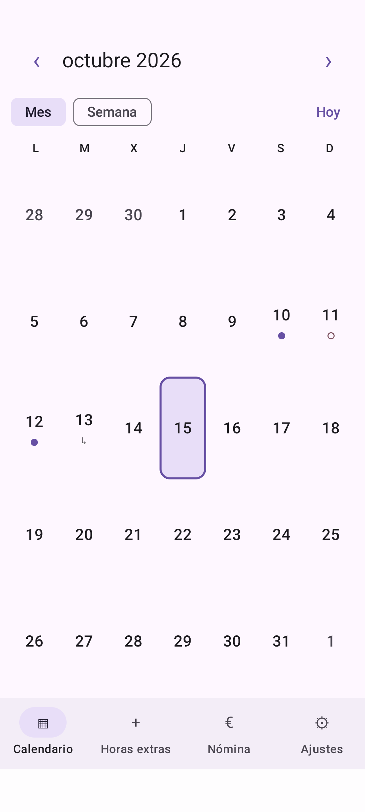
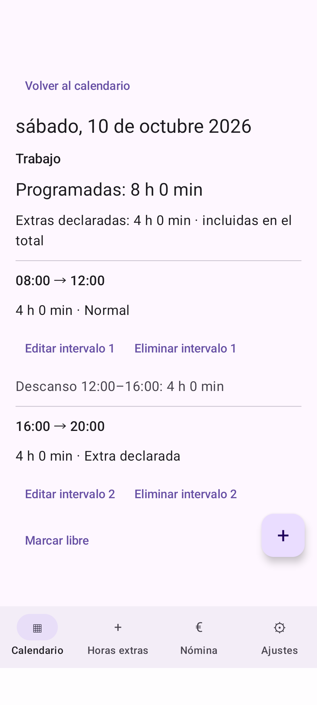
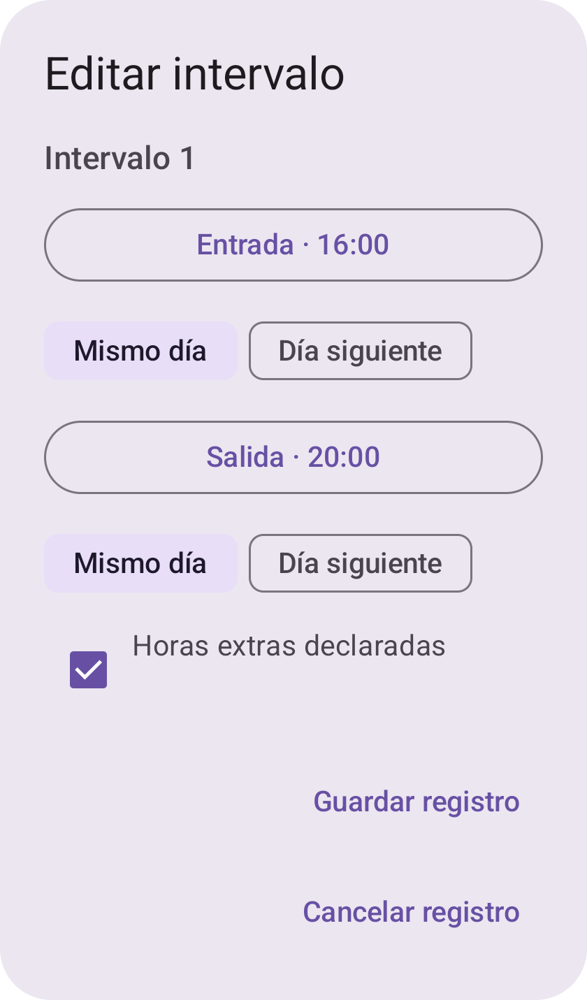
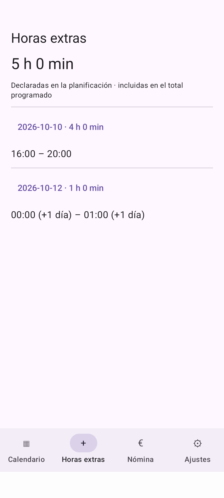

# TurnoControl

Aplicación Android nativa para organizar turnos programados en un calendario. Permite introducirlos manualmente o preparar propuestas desde una fotografía mediante OCR local, revisarlas y confirmar su guardado.

**Versión 0.1.0 — versión inicial en desarrollo.** Proyecto de portfolio, sin publicación de producción. No registra horas realmente trabajadas ni calcula nóminas.

## Funcionalidades

- Calendario mensual y semanal, navegación entre meses/años y acceso a Hoy.
- Días de trabajo, libres y sin configurar; detalle, edición y eliminación.
- Turnos normales y partidos, con precisión de minutos y cruces de medianoche. Las continuaciones pertenecen al día de inicio y no duplican registros.
- Extras declaradas por intervalo, incluidas en el total programado y mostradas también como subtotal. Los descansos entre intervalos no cuentan como trabajo.
- Persistencia local sin exigir contrato ni tarifas para usar el calendario.
- Photo Picker y selector de archivos Android, vista previa y ML Kit local.
- Interpretación de tablas con trabajadores en filas y fechas en columnas. Coincidencia exacta y selección explícita mediante lista o sobre la fotografía.
- Revisión y corrección manual antes de guardar, resolución de conflictos sin sobrescritura silenciosa y comprobación transaccional de cambios concurrentes.
- Configuración opcional de perfil, contrato y cinco tarifas, sin motor salarial; tema claro/oscuro persistente.

## Tecnologías y arquitectura

Kotlin, Jetpack Compose, Material 3, Navigation Compose, MVVM, StateFlow, coroutines, Hilt, Room, DataStore y Google ML Kit Text Recognition con modelo incluido.

Un módulo `app` con separación por responsabilidad:

```text
app/src/main/java/com/turnocontrol/
  ui/       Pantallas Compose y ViewModels
  domain/   Modelos, validación e intérpretes independientes de la interfaz
  data/     Room, repositorios, preferencias y reconocimiento local
  di/       Inyección mediante Hilt
app/schemas/          Esquemas Room 1–4
app/src/test/         JUnit y Robolectric
app/src/androidTest/  Interfaz, OCR y persistencia en Android
app/src/verification/ Soporte exclusivo de la variante aislada de pruebas
```

El OCR permanece provisional en memoria hasta confirmar los días. La planificación está separada de futuros fichajes reales. Las migraciones no destructivas preservan configuración y turnos existentes.

## Capturas con datos ficticios

Las imágenes proceden de la interfaz real de `verification`, con planificación sintética, sin fotografías laborales, identidades ni horarios personales. La fecha corresponde al mes de generación.

| Calendario | Detalle del día |
| --- | --- |
|  |  |
| Editor | Horas extras declaradas |
|  |  |

Generación y verificación: [preparación de v0.1.0](docs/PREPARACION_V0_1_0.md).

## Compilar desde un clon limpio

Requisitos: JDK 17 y Android SDK con `platforms;android-35`, `build-tools;35.0.0` y `platform-tools`. El Wrapper incluido utiliza Gradle 8.11.1; no hace falta Gradle global. Android mínimo: 8.0 / API 26.

Configura `JAVA_HOME` con tu JDK y `ANDROID_HOME` con tu SDK, o crea `local.properties` en la raíz (ignorado por Git):

```properties
sdk.dir=/ruta/al/Android/Sdk
```

En Windows puede usarse `sdk.dir=C:/ruta/al/Android/Sdk`. Instala los componentes y acepta sus licencias con Android Studio o las herramientas oficiales. La primera compilación necesita conexión para descargar Gradle y dependencias; no requiere secretos, cuentas ni servicios propios.

Windows:

```powershell
.\gradlew.bat --no-daemon --max-workers=1 assembleDebug testDebugUnitTest lintDebug lintVerification assembleVerificationAndroidTest
```

Linux/macOS:

```bash
./gradlew --no-daemon --max-workers=1 assembleDebug testDebugUnitTest lintDebug lintVerification assembleVerificationAndroidTest
```

APK: `app/build/outputs/apk/debug/app-debug.apk`, firmado con la clave de depuración de tu entorno. No se versionan APK ni claves. Un worker evita una carrera lint/kapt observada durante el desarrollo.

## Pruebas

Con un dispositivo o emulador autorizado y desbloqueado:

```bash
./gradlew --no-daemon --max-workers=1 connectedVerificationAndroidTest
```

En Windows sustituye `./gradlew` por `.\gradlew.bat`. Las pruebas usan `com.turnocontrol.verification`, separado de `com.turnocontrol`. Algunas sustituyen datos de la variante aislada por fixtures sintéticas: no deben redirigirse al paquete privado.

Para comprobar un reinicio real, compila `assembleVerification assembleVerificationAndroidTest` y ejecuta:

```powershell
pwsh -File ./scripts/verify-restart.ps1 -AdbPath /ruta/al/Android/Sdk/platform-tools/adb
```

En Windows también sirve Windows PowerShell y la ruta a `adb.exe`. Sin `-AdbPath`, se busca en `ANDROID_HOME`, `ANDROID_SDK_ROOT`, PATH y finalmente `.tools/android-sdk`. Requiere exactamente un dispositivo autorizado. Instala solo los APK aislados y verifica perfil, contrato, cinco tarifas, partidos, nocturnos y extras con PID distinto.

La preparación del 15/10/2026 registró **69 tests locales y 19 Android aprobados**, compilación correcta y lint sin errores, con 43/47 advertencias de mantenimiento. La prueba manual OCR del 15/10/2026 fue aprobada por el usuario para el formato probado. Resultados, incidencias y límites de la verificación: [PREPARACION_V0_1_0.md](docs/PREPARACION_V0_1_0.md).

Se prueban migraciones 1→4, 2→4 y 3→4, conservación de configuración, edición/eliminación, medianoche, extras, conflictos y regresión OCR. Las imágenes se generan con Canvas y datos ficticios; las respuestas de los selectores se simulan con Espresso Intents.

## Privacidad

- Sin cuentas ni backend; el manifiesto elimina permisos de Internet y estado de red.
- Sin permisos generales de almacenamiento: se utilizan URI de los selectores. Un proveedor externo puede descargar un archivo antes de entregarlo a la aplicación.
- Fotografías y documentos OCR completos no se persisten; el estado provisional se pierde al terminar el proceso.
- Datos en almacenamiento privado de Android; backup automático y transferencia desactivados.
- No se afirma cifrado adicional de la base de datos ni protección frente a un dispositivo comprometido.

## Limitaciones

- OCR sensible a perspectiva extrema, texto pequeño, desenfoque y geometría incompleta. No se adivinan horas ni fechas. Límite: 2048 píxeles por lado y 20 MiB por imagen.
- La estrategia semanal requiere siete fechas completas; la estrategia inicial admite otros diseños. No hay coincidencia aproximada automática de identidad.
- `LIB` es libre; `VAC` es ausencia provisional no guardable en Room 4. Celdas ambiguas requieren corrección. El OCR no infiere extras por colores o anotaciones.
- Precisión de minutos, desplazamientos de 0/1 día y máximo técnico de 24 horas por intervalo y sumadas por día de inicio; no son reglas laborales.
- Totales nominales de planificación, sin resolver automáticamente cambios de horario de verano. Sin fichajes, notificaciones, PDF ni cálculos salariales.
- Un perfil local, sin sincronización ni historial de vigencias de configuración.
- Cobertura manual limitada al formato probado y Samsung A53; pendiente una matriz de dispositivos y evaluación completa de accesibilidad.

## Estado y documentación

La versión inicial reúne calendario persistente, Room 4, rediseño e importación OCR revisada. Los informes históricos conservan el contexto de sus validaciones; las referencias a revisiones pendientes describen aquellas etapas.

- [Corrección OCR y aprobación manual](docs/CORRECCION_OCR_TABLAS.md)
- [Calendario y persistencia](docs/CALENDARIO.md)
- [Rediseño y Room 4](docs/REDISENO_INTERFAZ.md)
- [Preparación y cierre local de v0.1.0](docs/PREPARACION_V0_1_0.md)

## Licencia

El código propio de TurnoControl está bajo la [licencia MIT](LICENSE). Copyright (c) 2026 TurnoControl. Las dependencias y el Gradle Wrapper conservan sus licencias y condiciones propias; véase la revisión de terceros en [PREPARACION_V0_1_0.md](docs/PREPARACION_V0_1_0.md).
